<a id="TMP_7189"></a>

# Cycling part 2
<!-- Begin Toc -->

## Table of Contents
&emsp;&emsp;[Setup Python environment](#TMP_3565)
 
&emsp;&emsp;[Garmin export](#TMP_5fda)
 
&emsp;&emsp;[Metrics](#TMP_12f1)
 
&emsp;&emsp;[Animation](#H_11aa)
 
&emsp;&emsp;[Analysis](#TMP_9cdd)
 
&emsp;&emsp;&emsp;[1) Clean & derive signals (once per ride)](#TMP_0292)
 
&emsp;&emsp;&emsp;[2) Baseline metrics (what matters for improvement)](#TMP_9fe5)
 
&emsp;&emsp;&emsp;[3) Power (no power meter? estimate it)](#TMP_5390)
 
&emsp;&emsp;&emsp;[4) Power\-duration & rolling bests (find limiter)](#TMP_44fa)
 
&emsp;&emsp;&emsp;[5) Route\-matched comparison (your “ghost”)](#TMP_3f82)
 
&emsp;&emsp;&emsp;[6) Pacing & fatigue diagnostics](#TMP_2dd1)
 
&emsp;&emsp;[Utils](#TMP_7eb7)
 
<!-- End Toc -->
<a id="TMP_3565"></a>

## Setup Python environment

**prompt**


how to get pip

```matlab
!curl https://bootstrap.pypa.io/get-pip.py -o /tmp/get-pip.py
```

```matlabTextOutput
curl: /MATLAB/bin/glnxa64/libcurl.so.4: no version information available (required by curl)
  % Total    % Received % Xferd  Average Speed   Time    Time     Time  Current
                                 Dload  Upload   Total   Spent    Left  Speed

  0     0    0     0    0     0      0      0 --:--:-- --:--:-- --:--:--     0
100 2098k  100 2098k    0     0  30.0M      0 --:--:-- --:--:-- --:--:-- 30.1M
```

```matlab
!python /tmp/get-pip.py
```

```matlabTextOutput
Defaulting to user installation because normal site-packages is not writeable
Collecting pip
  Downloading pip-25.2-py3-none-any.whl.metadata (4.7 kB)
Collecting setuptools
  Downloading setuptools-80.9.0-py3-none-any.whl.metadata (6.6 kB)
Collecting wheel
  Downloading wheel-0.45.1-py3-none-any.whl.metadata (2.3 kB)
Downloading pip-25.2-py3-none-any.whl (1.8 MB)
[?25l   ━━━━━━━━━━━━━━━━━━━━━━━━━━━━━━━━━━━━━━━━ 0.0/1.8 MB ? eta -:--:--
   ━━━━━━━━━━━━━━━━━━━━━━━━━━━━━━━━━━━━━━━━ 1.8/1.8 MB 41.8 MB/s  0:00:00
[?25hDownloading setuptools-80.9.0-py3-none-any.whl (1.2 MB)
[?25l   ━━━━━━━━━━━━━━━━━━━━━━━━━━━━━━━━━━━━━━━━ 0.0/1.2 MB ? eta -:--:--
   ━━━━━━━━━━━━━━━━━━━━━━━━━━━━━━━━━━━━━━━━ 1.2/1.2 MB 100.2 MB/s  0:00:00
[?25hDownloading wheel-0.45.1-py3-none-any.whl (72 kB)
Installing collected packages: wheel, setuptools, pip
[?25l  WARNING: The script wheel is installed in '/home/matlab/.local/bin' which is not on PATH.
  Consider adding this directory to PATH or, if you prefer to suppress this warning, use --no-warn-script-location.

   ━━━━━━━━━━━━━╺━━━━━━━━━━━━━━━━━━━━━━━━━━ 1/3 [setuptools]
   ━━━━━━━━━━━━━╺━━━━━━━━━━━━━━━━━━━━━━━━━━ 1/3 [setuptools]
   ━━━━━━━━━━━━━╺━━━━━━━━━━━━━━━━━━━━━━━━━━ 1/3 [setuptools]
   ━━━━━━━━━━━━━━━━━━━━━━━━━━╸━━━━━━━━━━━━━ 2/3 [pip]
   ━━━━━━━━━━━━━━━━━━━━━━━━━━╸━━━━━━━━━━━━━ 2/3 [pip]
   ━━━━━━━━━━━━━━━━━━━━━━━━━━╸━━━━━━━━━━━━━ 2/3 [pip]  WARNING: The scripts pip, pip3 and pip3.10 are installed in '/home/matlab/.local/bin' which is not on PATH.
  Consider adding this directory to PATH or, if you prefer to suppress this warning, use --no-warn-script-location.

   ━━━━━━━━━━━━━━━━━━━━━━━━━━━━━━━━━━━━━━━━ 3/3 [pip]
[?25h
Successfully installed pip-25.2 setuptools-80.9.0 wheel-0.45.1
```

```matlab
!python -m pip --version
```

```matlabTextOutput
pip 25.2 from /home/matlab/.local/lib/python3.10/site-packages/pip (python 3.10)
```

```matlab
!python -m pip install garmin-fit-sdk pandas
```

```matlabTextOutput
Defaulting to user installation because normal site-packages is not writeable
Collecting garmin-fit-sdk
  Downloading garmin_fit_sdk-21.178.0-py2.py3-none-any.whl.metadata (9.0 kB)
Collecting pandas
  Downloading pandas-2.3.2-cp310-cp310-manylinux_2_17_x86_64.manylinux2014_x86_64.whl.metadata (91 kB)
Collecting numpy>=1.22.4 (from pandas)
  Downloading numpy-2.2.6-cp310-cp310-manylinux_2_17_x86_64.manylinux2014_x86_64.whl.metadata (62 kB)
Collecting python-dateutil>=2.8.2 (from pandas)
  Downloading python_dateutil-2.9.0.post0-py2.py3-none-any.whl.metadata (8.4 kB)
Collecting pytz>=2020.1 (from pandas)
  Downloading pytz-2025.2-py2.py3-none-any.whl.metadata (22 kB)
Collecting tzdata>=2022.7 (from pandas)
  Downloading tzdata-2025.2-py2.py3-none-any.whl.metadata (1.4 kB)
Requirement already satisfied: six>=1.5 in /usr/lib/python3/dist-packages (from python-dateutil>=2.8.2->pandas) (1.16.0)
Downloading garmin_fit_sdk-21.178.0-py2.py3-none-any.whl (238 kB)
Downloading pandas-2.3.2-cp310-cp310-manylinux_2_17_x86_64.manylinux2014_x86_64.whl (12.3 MB)
[?25l   ━━━━━━━━━━━━━━━━━━━━━━━━━━━━━━━━━━━━━━━━ 0.0/12.3 MB ? eta -:--:--
   ━━━━━━━━━━━━━━━━━━━━━━━━━━━━━━━━━━━━━━━━ 12.3/12.3 MB 226.1 MB/s  0:00:00
[?25hDownloading numpy-2.2.6-cp310-cp310-manylinux_2_17_x86_64.manylinux2014_x86_64.whl (16.8 MB)
[?25l   ━━━━━━━━━━━━━━━━━━━━━━━━━━━━━━━━━━━━━━━━ 0.0/16.8 MB ? eta -:--:--
   ━━━━━━━━━━━━━━━━━━━━━━━━━━━━━━━━━━━━━━━━ 16.8/16.8 MB 295.6 MB/s  0:00:00
[?25hDownloading python_dateutil-2.9.0.post0-py2.py3-none-any.whl (229 kB)
Downloading pytz-2025.2-py2.py3-none-any.whl (509 kB)
Downloading tzdata-2025.2-py2.py3-none-any.whl (347 kB)
Installing collected packages: pytz, tzdata, python-dateutil, numpy, garmin-fit-sdk, pandas
[?25l
   ━━━━━━━━━━━━━╺━━━━━━━━━━━━━━━━━━━━━━━━━━ 2/6 [python-dateutil]
   ━━━━━━━━━━━━━━━━━━━━╺━━━━━━━━━━━━━━━━━━━ 3/6 [numpy]
   ━━━━━━━━━━━━━━━━━━━━╺━━━━━━━━━━━━━━━━━━━ 3/6 [numpy]
   ━━━━━━━━━━━━━━━━━━━━╺━━━━━━━━━━━━━━━━━━━ 3/6 [numpy]
   ━━━━━━━━━━━━━━━━━━━━╺━━━━━━━━━━━━━━━━━━━ 3/6 [numpy]
   ━━━━━━━━━━━━━━━━━━━━╺━━━━━━━━━━━━━━━━━━━ 3/6 [numpy]
   ━━━━━━━━━━━━━━━━━━━━╺━━━━━━━━━━━━━━━━━━━ 3/6 [numpy]
   ━━━━━━━━━━━━━━━━━━━━╺━━━━━━━━━━━━━━━━━━━ 3/6 [numpy]
   ━━━━━━━━━━━━━━━━━━━━╺━━━━━━━━━━━━━━━━━━━ 3/6 [numpy]
   ━━━━━━━━━━━━━━━━━━━━╺━━━━━━━━━━━━━━━━━━━ 3/6 [numpy]  WARNING: The scripts f2py and numpy-config are installed in '/home/matlab/.local/bin' which is not on PATH.
  Consider adding this directory to PATH or, if you prefer to suppress this warning, use --no-warn-script-location.

   ━━━━━━━━━━━━━━━━━━━━━━━━━━╸━━━━━━━━━━━━━ 4/6 [garmin-fit-sdk]
   ━━━━━━━━━━━━━━━━━━━━━━━━━━━━━━━━━╺━━━━━━ 5/6 [pandas]
   ━━━━━━━━━━━━━━━━━━━━━━━━━━━━━━━━━╺━━━━━━ 5/6 [pandas]
   ━━━━━━━━━━━━━━━━━━━━━━━━━━━━━━━━━╺━━━━━━ 5/6 [pandas]
   ━━━━━━━━━━━━━━━━━━━━━━━━━━━━━━━━━╺━━━━━━ 5/6 [pandas]
   ━━━━━━━━━━━━━━━━━━━━━━━━━━━━━━━━━╺━━━━━━ 5/6 [pandas]
   ━━━━━━━━━━━━━━━━━━━━━━━━━━━━━━━━━╺━━━━━━ 5/6 [pandas]
   ━━━━━━━━━━━━━━━━━━━━━━━━━━━━━━━━━╺━━━━━━ 5/6 [pandas]
   ━━━━━━━━━━━━━━━━━━━━━━━━━━━━━━━━━╺━━━━━━ 5/6 [pandas]
   ━━━━━━━━━━━━━━━━━━━━━━━━━━━━━━━━━╺━━━━━━ 5/6 [pandas]
   ━━━━━━━━━━━━━━━━━━━━━━━━━━━━━━━━━╺━━━━━━ 5/6 [pandas]
   ━━━━━━━━━━━━━━━━━━━━━━━━━━━━━━━━━╺━━━━━━ 5/6 [pandas]
   ━━━━━━━━━━━━━━━━━━━━━━━━━━━━━━━━━╺━━━━━━ 5/6 [pandas]
   ━━━━━━━━━━━━━━━━━━━━━━━━━━━━━━━━━╺━━━━━━ 5/6 [pandas]
   ━━━━━━━━━━━━━━━━━━━━━━━━━━━━━━━━━╺━━━━━━ 5/6 [pandas]
   ━━━━━━━━━━━━━━━━━━━━━━━━━━━━━━━━━╺━━━━━━ 5/6 [pandas]
   ━━━━━━━━━━━━━━━━━━━━━━━━━━━━━━━━━╺━━━━━━ 5/6 [pandas]
   ━━━━━━━━━━━━━━━━━━━━━━━━━━━━━━━━━╺━━━━━━ 5/6 [pandas]
   ━━━━━━━━━━━━━━━━━━━━━━━━━━━━━━━━━╺━━━━━━ 5/6 [pandas]
   ━━━━━━━━━━━━━━━━━━━━━━━━━━━━━━━━━━━━━━━━ 6/6 [pandas]
[?25h
Successfully installed garmin-fit-sdk-21.178.0 numpy-2.2.6 pandas-2.3.2 python-dateutil-2.9.0.post0 pytz-2025.2 tzdata-2025.2
```

```matlab
pe = pyenv(ExecutionMode="OutOfProcess")
```

```matlabTextOutput
pe = 
  PythonEnvironment with properties:

          Version: "3.10"
       Executable: "/usr/bin/python3"
          Library: "libpython3.10.so.1.0"
             Home: "/usr"
           Status: Terminated
    ExecutionMode: OutOfProcess

```

<a id="TMP_5fda"></a>

## Garmin export
```matlab
l = dir("*.fit")
```


|Fields|name|folder|date|bytes|isdir|datenum|
|:--:|:--:|:--:|:--:|:--:|:--:|:--:|
|1|'garmin.fit'|'/MATLAB Drive/cycling'|'29-Jun-2025 15:10:34'|21765|0|7.3980e+05|
|2|'garmin2.fit'|'/MATLAB Drive/cycling'|'29-Sep-2025 19:26:05'|75162|0|7.3989e+05|


```matlab
l(2)
```

```matlabTextOutput
ans = struct with fields:
       name: 'garmin2.fit'
     folder: '/MATLAB Drive/cycling'
       date: '29-Sep-2025 19:26:05'
      bytes: 75162
      isdir: 0
    datenum: 7.3989e+05

```

```matlab
df = py.export_fit.fit2df(l(2).name);
T = timetable(df)
```


| |timestamp|position_lat|position_long|distance|enhanced_speed|enhanced_altitude|
|:--:|:--:|:--:|:--:|:--:|:--:|:--:|
|1|29-Sep-2025 16:41:59|42.3812|-71.2365|2.5300|3.5640|15.2000|
|2|29-Sep-2025 16:42:00|42.3812|-71.2365|6.4600|3.1440|15|
|3|29-Sep-2025 16:42:02|42.3813|-71.2366|15.2500|3.9750|15.4000|
|4|29-Sep-2025 16:42:07|42.3812|-71.2369|38.6200|5.8410|17|
|5|29-Sep-2025 16:42:11|42.3812|-71.2372|62.0600|5.9160|16.4000|
|6|29-Sep-2025 16:42:13|42.3812|-71.2373|74.2000|6.2890|15.8000|
|7|29-Sep-2025 16:42:18|42.3811|-71.2377|105.7400|6|14.6000|
|8|29-Sep-2025 16:42:19|42.3811|-71.2378|112.1000|5.9620|14|
|9|29-Sep-2025 16:42:20|42.3811|-71.2378|118.1600|5.7570|13.6000|
|10|29-Sep-2025 16:42:27|42.3811|-71.2383|158.6600|5.9810|13.6000|
|11|29-Sep-2025 16:42:29|42.3811|-71.2385|171.5200|6.0650|14.4000|
|12|29-Sep-2025 16:42:32|42.3810|-71.2387|190.5400|5.7760|15.8000|
|13|29-Sep-2025 16:42:38|42.3810|-71.2392|229.2000|6.5410|18|
|14|29-Sep-2025 16:42:43|42.3809|-71.2396|263.7100|6.3730|21.4000|


```matlab
figure
g = geoaxes;               % create a geographic axes
geoscatter(g, T.position_lat, T.position_long, 60,T.enhanced_speed, 'filled')
title('My Garmin Track')
```

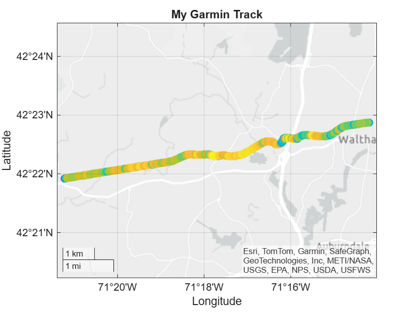
<a id="TMP_12f1"></a>

## Metrics
```matlab
duration = T.timestamp(end)-T.timestamp(1)
```

```matlabTextOutput
duration = duration
   00:52:34

```

```matlab
meanspeed = mean(T.enhanced_speed) % m/s
```

```matlabTextOutput
meanspeed = 6.1437
```

```matlab
meanspeedkmh = meanspeed * 3.6
```

```matlabTextOutput
meanspeedkmh = 22.1172
```

<a id="H_11aa"></a>

## Animation

Animate (limited to 1000 frames)

```matlab
clf
% Extract variables
lat = T.position_lat;
lon = T.position_long;
speed = T.enhanced_speed;
time = T.timestamp;
% Create figure
fig = figure('Color', 'w');

% Create geoaxes and fill entire figure
gax = geoaxes(fig, 'Position', [0 0 1 1]);
% geobasemap(gax, 'streets')  % or 'topographic', 'satellite', etc.
hold(gax, 'on')

% Initial trail plot
trail = geoscatter(lat(1), lon(1), 60, speed(1), 'filled'); % trail of the path

% colormap turbo
clim([min(speed), max(speed)])
colorbar('off')
hold(gax,'off')

% Set map view to cover the whole route
geolimits([min(lat)-0.001, max(lat)+0.001], [min(lon)-0.001, max(lon)+0.001])

% Animation loop, only every 4th frame
for k = 1:4:length(lat)
    set(trail, ...
        'LatitudeData', lat(1:k), ...
        'LongitudeData', lon(1:k), ...
        'CData', speed(1:k));  % color by speed
    
    % title(string(time(k)), 'FontSize', 14)
    drawnow
end
```

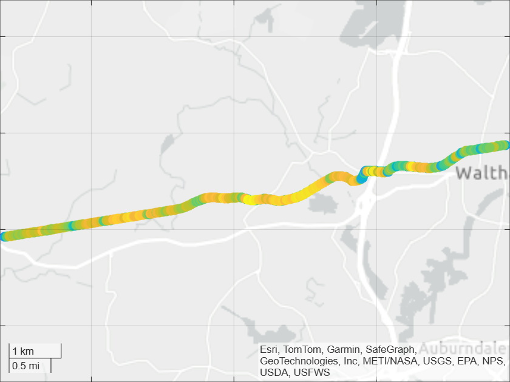
<a id="TMP_9cdd"></a>

## Analysis
<a id="TMP_0292"></a>

### 1) Clean & derive signals (once per ride)
-  Resample to 1 Hz; smooth altitude; compute **grade**, **acceleration**, **moving time**. 
-  Check units: `enhanced_speed` is usually m/s; `distance` meters. 
```matlab
TT = prepRide(T)
```


| |timestamp|position_lat|position_long|distance|enhanced_speed|enhanced_altitude|alt_smooth|grade|accel|isStopped|
|:--:|:--:|:--:|:--:|:--:|:--:|:--:|:--:|:--:|:--:|:--:|
|1|29-Sep-2025 16:41:59|42.3812|-71.2365|2.5300|3.5640|15.2000|15.7446|0.0151|0|false|
|2|29-Sep-2025 16:42:00|42.3812|-71.2365|6.4600|3.1440|15|15.8039|0.0130|-0.4200|false|
|3|29-Sep-2025 16:42:01|42.3813|-71.2366|10.8550|3.5595|15.2000|15.8525|0.0098|0.4155|false|
|4|29-Sep-2025 16:42:02|42.3813|-71.2366|15.2500|3.9750|15.4000|15.8904|0.0072|0.4155|false|
|5|29-Sep-2025 16:42:03|42.3813|-71.2367|19.9240|4.3482|15.7200|15.9177|0.0047|0.3732|false|
|6|29-Sep-2025 16:42:04|42.3812|-71.2367|24.5980|4.7214|16.0400|15.9342|0.0024|0.3732|false|
|7|29-Sep-2025 16:42:05|42.3812|-71.2368|29.2720|5.0946|16.3600|15.9401|1.0828e-04|0.3732|false|
|8|29-Sep-2025 16:42:06|42.3812|-71.2368|33.9460|5.4678|16.6800|15.9352|-0.0022|0.3732|false|
|9|29-Sep-2025 16:42:07|42.3812|-71.2369|38.6200|5.8410|17|15.9197|-0.0040|0.3732|false|
|10|29-Sep-2025 16:42:08|42.3812|-71.2370|44.4800|5.8598|16.8500|15.8935|-0.0054|0.0187|false|
|11|29-Sep-2025 16:42:09|42.3812|-71.2370|50.3400|5.8785|16.7000|15.8565|-0.0072|0.0188|false|
|12|29-Sep-2025 16:42:10|42.3812|-71.2371|56.2000|5.8973|16.5500|15.8089|-0.0090|0.0187|false|
|13|29-Sep-2025 16:42:11|42.3812|-71.2372|62.0600|5.9160|16.4000|15.7506|-0.0107|0.0187|false|
|14|29-Sep-2025 16:42:12|42.3812|-71.2372|68.1300|6.1025|16.1000|15.6816|-0.0122|0.1865|false|


I only stopped once

```matlab
TT(TT.isStopped == true,:)
```


| |timestamp|position_lat|position_long|distance|enhanced_speed|enhanced_altitude|alt_smooth|grade|accel|isStopped|
|:--:|:--:|:--:|:--:|:--:|:--:|:--:|:--:|:--:|:--:|:--:|
|1|29-Sep-2025 17:10:06|42.3654|-71.3537|1.0145e+04|0|46.2000|45.8656|0.0580|-1.2223|true|


```matlab
clf
stackedplot(TT,{"enhanced_altitude","alt_smooth"})
```

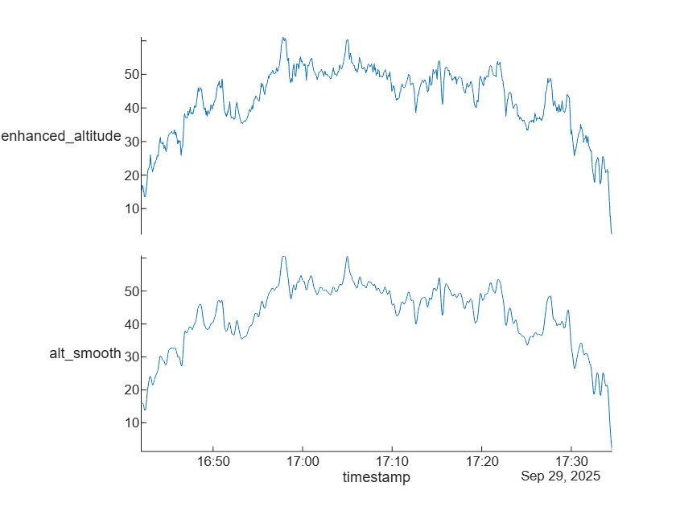

```matlab
plot(TT.timestamp,TT.grade)
title("Grade = rise over run (Δaltitude / Δdistance)")
ylabel("%")
```

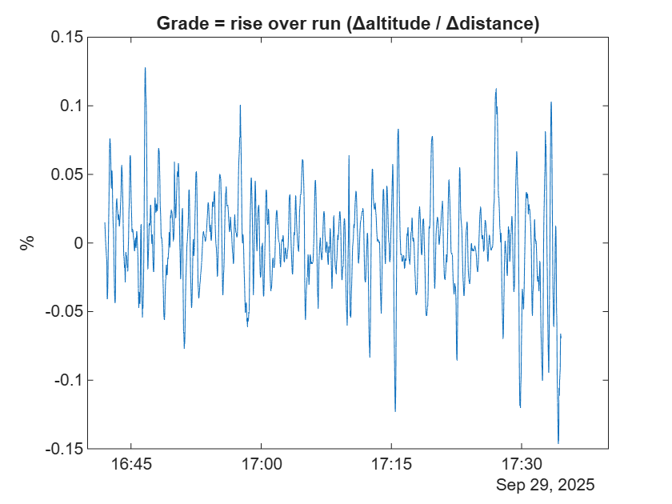

Grade is simply the **road slope** at each point, expressed as *rise over run* (Δaltitude / Δdistance).


In cycling, it’s usually shown as a **percentage**:

 $$ \textrm{Grade (\%)} =\frac{\Delta \textrm{altitude}}{\Delta \textrm{horizontal}\;\textrm{distance}}\times 100 $$ 

Example: If you climb 5 m vertically over 100 m horizontally, grade = 5%.

<a id="TMP_9fe5"></a>

### 2) Baseline metrics (what matters for improvement)
-  **Distance / Elevation gain / Moving time / % Stopped** 
-  **Speed percentiles** (P50/P90) and **VAM** (vertical m/h) on climbs 
-  **Speed vs grade curve** → shows where you’re weak (e.g., 3–6% grades) 
```matlab
s = baselineStats(TT)
```

```matlabTextOutput
s = struct with fields:
                km: 20.0243
        elevGain_m: 239.4040
    movingTime_min: 3154 min
        pctStopped: 0.0317
     P50_speed_kph: 22.6059
     P90_speed_kph: 27.5630
           VAM_mph: 273.2576

```

```matlab
edges = [-Inf -6 -3 0 3 6 9 12 Inf]/100;  % grade in fraction
[G,ed] = discretize(TT.grade,edges);
boxchart(100*ed(G),3.6*TT.enhanced_speed); xlabel('Grade (%)'); ylabel('Speed (km/h)');
```

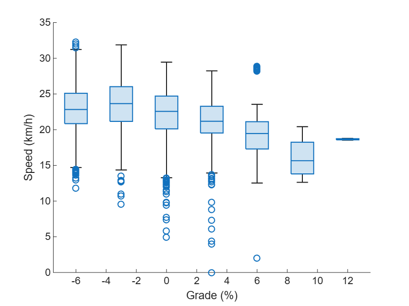
<a id="TMP_5390"></a>

### 3) Power (no power meter? estimate it)

A physics\-based estimate is good enough for trends, NP/IF, and comparing rides.


**Model** (no wind, tweak params):

-  Aerodynamic: 0.5 ρ.Cd.Av^3 
-  Rolling: Crr.m.g.v.cos⁡θ 
-  Gravity: m.g.v.sin⁡θ 
-  Inertial: m.a.v 
```matlab
P = estPower(TT);
plot(TT.timestamp,P)
title("Estimated cycling power output from physics")
ylabel('Watts')
```

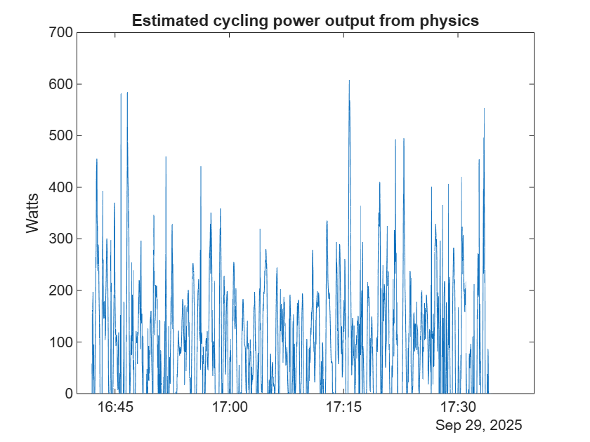

This gives you a time series of estimated power (watts). With it, you can calculate:

-  **Normalized Power (NP)** – better than average power, because it accounts for variability. 
-  **FTP estimate** – functional threshold power (~best 1 h effort). 
-  **Intensity Factor (IF)** – how hard the ride was relative to your FTP. 
-  **Training Stress Score (TSS)** – how much training load you accumulated. 
```matlab
dt = 1; % since we resampled at 1Hz (one row per second)
M = loadMetrics(P, dt)
```

```matlabTextOutput
M = struct with fields:
         NP: 144.1987
    FTP_est: 110.0119
         IF: 1.3108
        TSS: 80.8264

```


If you don’t resample, and your timestamps are irregular (e.g., some 0.9 s, some 1.3 s), you can compute the mean interval:


`dt = mean(seconds(diff(TT.Time)));`

<a id="TMP_44fa"></a>

### 4) Power\-duration & rolling bests (find limiter)

Rolling bests show your strengths/limiters (sprint, 5\-min VO₂, 20\-min threshold):


**The Idea**


Cyclists often look at a **power\-duration curve**:

-  On the x\-axis: effort duration (seconds, minutes, up to 1–2 h). 
-  On the y\-axis: **maximum average power** you could sustain for that duration. 

This curve shows your *physiological profile*: sprinter, time\-trialist, climber, etc.


It highlights which time ranges are strong and which are weak.


**How It’s Computed**


We don’t just look at instantaneous power (spiky, not useful).


Instead, we compute **rolling averages** of the power time series for different window lengths:

-  5 s (sprint) 
-  15–30 s (anaerobic) 
-  1–2 min (hard VO₂max effort) 
-  5–6 min (long VO₂ interval) 
-  20 min (threshold proxy) 
-  60 min (FTP benchmark) 

For each duration w, compute:

 $$ P_w =\max_t \left(\frac{1}{w}\sum_{i=0}^{w-1} P_{t+i} \right) $$ 

Where:

-  Pt​ is the power at time sample t. 
-  w is the window length (in samples, e.g. 5 s, 20 min). 
-  The maximum is taken over all possible starting points t in the ride. 
```matlab
pd = powerDuration(P)
```


| |sec|bestW|
|:--:|:--:|:--:|
|1|5|577.6654|
|2|15|491.7911|
|3|30|318.8674|
|4|60|200.7726|
|5|120|185.5319|
|6|300|153.4456|
|7|600|130.7127|
|8|1200|115.8020|


```matlab
loglog(pd.sec, pd.bestW, '-o');
title("Power-Duration Curve")
xlabel('Duration (s)'); ylabel('Best Power (W)');
grid on;
```

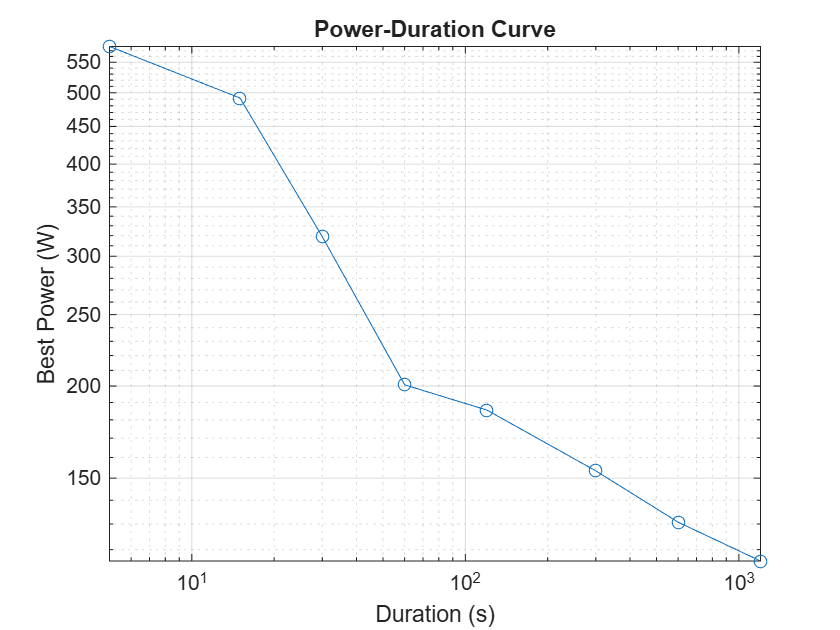

Train the limiter you find (e.g., if 300–600 s is weak → 3–6 min over/unders on 3–6% climbs).

<a id="TMP_3f82"></a>

### 5) Route\-matched comparison (your “ghost”)

For your **two rides on the same route**, align by distance and compute where time was won/lost.

```matlab
df1 = py.export_fit.fit2df(l(1).name);
T1 = timetable(df1);
TT1 = prepRide(T1);
TT1(TT1.isStopped == true,:) % I stopped often in the previous ride, to manage the recording with MATLAB Mobile
```


| |timestamp|position_lat|position_long|distance|enhanced_speed|enhanced_altitude|alt_smooth|grade|accel|isStopped|
|:--:|:--:|:--:|:--:|:--:|:--:|:--:|:--:|:--:|:--:|:--:|
|1|21-Jun-2025 20:54:32|42.3812|-71.2366|0|0|18|18.4992|-1.5995e+05|0|true|
|2|21-Jun-2025 20:54:33|42.3812|-71.2366|0|0|18|18.3393|-1.5403e+05|0|true|
|3|21-Jun-2025 20:54:34|42.3812|-71.2366|0|0.0321|18|18.1911|-1.4220e+05|0.0321|true|
|4|21-Jun-2025 20:54:35|42.3812|-71.2366|0|0.0642|18|18.0549|-1.3036e+05|0.0321|true|
|5|21-Jun-2025 20:54:36|42.3812|-71.2366|0|0.0963|18|17.9304|-1.1852e+05|0.0321|true|
|6|21-Jun-2025 20:54:37|42.3812|-71.2366|0|0.1284|18|17.8178|-1.0669e+05|0.0321|true|
|7|21-Jun-2025 20:54:38|42.3812|-71.2366|0|0.1606|18|17.7170|-9.4853e+04|0.0321|true|
|8|21-Jun-2025 20:54:39|42.3812|-71.2366|0|0.1927|18|17.6281|-8.3018e+04|0.0321|true|
|9|21-Jun-2025 20:54:40|42.3812|-71.2366|0|0.2248|18|17.5510|-7.1182e+04|0.0321|true|
|10|21-Jun-2025 20:54:41|42.3812|-71.2366|0|0.2569|18|17.4857|-5.9347e+04|0.0321|true|
|11|21-Jun-2025 20:54:42|42.3812|-71.2366|0|0.2890|18|17.4323|-0.1118|0.0321|true|
|12|21-Jun-2025 21:11:37|42.3721|-71.2924|5.3056e+03|0.4918|49.9430|49.9430|0.4082|-0.0093|true|
|13|21-Jun-2025 21:11:38|42.3721|-71.2924|5.3056e+03|0.4825|49.9441|49.9441|0.4082|-0.0093|true|
|14|21-Jun-2025 21:11:39|42.3721|-71.2924|5.3056e+03|0.4733|49.9452|49.9452|0.4082|-0.0093|true|


```matlab
comp = compareRides(TT, TT1)
```


| |m|tA_s|tB_s|timeLead_s|vA_kph|vB_kph|grade|
|:--:|:--:|:--:|:--:|:--:|:--:|:--:|:--:|
|1|0|-0.6933|0|0.6933|13.8038|0|0.0165|
|2|5|0.6409|14.8777|14.2368|11.8801|6.3554|0.0138|
|3|10|1.8072|16.6152|14.8080|12.5232|8.6833|0.0105|
|4|15|2.9447|18.3299|15.3852|14.2249|11.1598|0.0073|
|5|20|4.0163|20.0362|16.0199|15.6754|13.5983|0.0046|
|6|25|5.0860|21.1972|16.1112|17.1126|14.6107|0.0022|
|7|30|6.1558|22.3641|16.2083|18.5498|15.6231|-2.4803e-04|
|8|35|7.2298|23.5309|16.3011|19.9870|16.6354|-0.0026|
|9|40|8.2516|24.6978|16.4461|21.0435|17.6478|-0.0043|
|10|45|9.0887|25.8816|16.7928|21.1011|18.6602|-0.0055|
|11|50|9.9420|26.7334|16.7914|21.1587|19.2148|-0.0071|
|12|55|10.7952|27.5407|16.7455|21.2163|19.7094|-0.0087|
|13|60|11.6511|28.3585|16.7075|21.2739|20.2040|-0.0101|
|14|65|12.4866|29.1763|16.6897|21.6228|20.6986|-0.0114|


Plot `timeLead_s` vs distance and color by grade → you’ll *see exactly* where you lost time (e.g., braking before corners, fade on last climb, slow remounts after stops).

```matlab
plot_timelead(comp)
```

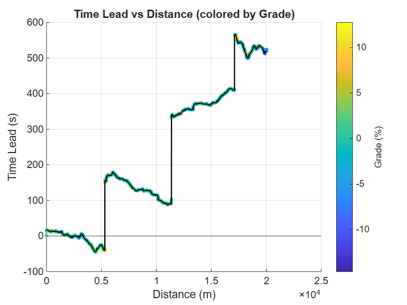
<a id="TMP_5d30"></a>

**What the plot means**

-  **X\-axis (Distance):** progress along the ride in meters. 
-  **Y\-axis (Time Lead):** how far ahead Ride B is relative to Ride A. 
-  > 0 → Ride B is **ahead** (Ride A is behind). 
-  < 0 → Ride A is ahead. 
-  **Color (Grade):** slope of the road at that section. 

So the blue/green/yellow dots track whether gains/losses happened on flats, climbs, or descents.

<a id="TMP_67fc"></a>

**Interpreting the plot**

-  **Start (0–5 km):** almost even, with small oscillations; you actually dip below zero briefly → Ride A was ahead here. 
-  **~5 km mark:** sudden vertical jump in time\-lead (goes from near zero to ~150 s). That looks like a **pause, stop, or long slowdown** in Ride A. The vertical step means time passed without covering distance. 
-  **5–10 km:** gradual increase in time\-lead (Ride A steadily losing time). This suggests pacing differences or stronger effort in Ride B. 
-  **~10 km:** another **step jump** in time lost (~+200 s). Again, almost certainly a stop or interruption. 
-  **10–20 km:** time\-lead keeps climbing — by 20 km, Ride B is 500+ seconds ahead. You see little wiggles that align with climbs/descents (colors), but the **trend is steady loss of time**. 
-  **Near 20 km:** a third big vertical step → another stop. 
<a id="TMP_1cc4"></a>

**Key takeaways**

1.  **Most of the time gap isn’t from riding slower — it’s from stops.** The vertical steps dominate the plot.
2. Between stops, Ride B is still a bit faster — the slope of the curve (time\-lead rising gradually) shows steady seconds being lost.
3. Grade coloring shows losses happen across all terrain, not just climbs or flats. That means the stops + a general pace difference explain the gap.

Sum gains/losses by grade bin or by automatically segmented chunks (changepoint on grade/speed).

```matlab
bin_table = gains_losses_by_grade(comp)
```

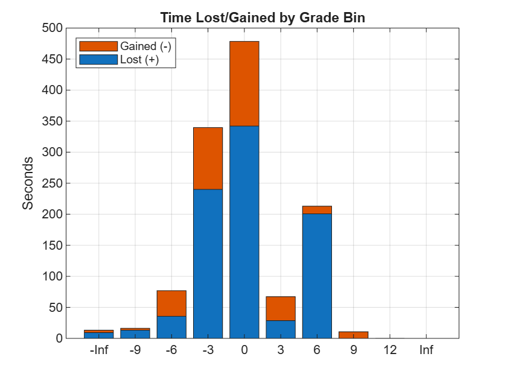


| |GradeBin|TotalLoss_s|TotalGain_s|NetLoss_s|
|:--:|:--:|:--:|:--:|:--:|
|1|-Inf|9.2844|3.8780|5.4064|
|2|-9|13.2030|3.0915|10.1114|
|3|-6|35.6335|41.2425|-5.6090|
|4|-3|240.0644|99.6116|140.4529|
|5|0|342.0932|136.4438|205.6493|
|6|3|28.5998|38.6198|-10.0201|
|7|6|200.6968|12.3087|188.3880|
|8|9|0.0379|10.6010|-10.5631|
|9|12|0|0.1535|-0.1535|
|10|Inf|0|0|0|


<a id="TMP_2dd1"></a>

### 6) Pacing & fatigue diagnostics

**Decoupling**: correlation between speed and estimated power drops late in the ride → fatigue. 


Compute Pearson r in first vs last third.

-  `r1`: correlation between speed and estimated power in the **first third** of the ride. 
-  `r3`: same but for the **last third**. 
-  If `decoupling` is large and positive, it means speed and power are **less coupled later** → you’re fatiguing (producing the same watts but not holding speed, often from aero, terrain, or fatigue). 
```matlab
n = height(TT);                   % number of rows
cut1 = floor(n/3);                % end of first third
cut2 = floor(2*n/3);              % end of second third

r1 = corr(TT.enhanced_speed(1:cut1), P(1:cut1));
r3 = corr(TT.enhanced_speed(cut2+1:end), P(cut2+1:end));
decoupling = r1 - r3
```

```matlabTextOutput
decoupling = -0.0228
```


**Stops/slow coasts**: count and total time; practice rolling through junctions safely.

<a id="TMP_0dd7"></a>

**Why track stops**

-  **Stops** (traffic lights, water breaks, waiting at junctions) → show up as vertical jumps in your “ghost” plots. They inflate elapsed time without affecting moving time. 
-  **Slow coasts** (speed near zero, power near zero) → are “hidden” stops where you’re soft\-pedaling or freewheeling. 

If you want to **compare performance between rides**, you need to separate *fitness\-driven losses* (fading on climbs, poor pacing) from *logistical losses* (waiting at lights).

-  Detect stops: 
```matlab
% speed < 0.5 m/s considered a stop
stopMask = TT.enhanced_speed < 0.5;

% Count total stops (transitions into stopMask)
nStops = sum(diff([0; stopMask])==1);

% Total stopped time (seconds)
stopTime = sum(stopMask);

fprintf('Stops: %d, Total stopped: %.1f min\n', nStops, stopTime/60);
```

```matlabTextOutput
Stops: 1, Total stopped: 0.0 min
```

-  Detect slow coasts: 
```matlab
% Coasting = power ~ 0 while speed > 0
estP = estPower(TT);    % numeric watts (from earlier section)
coastMask = (TT.enhanced_speed > 1.0) & (estP < 20);

coastTime = sum(coastMask);
fprintf('Coasting time: %.1f min\n', coastTime/60);
```

```matlabTextOutput
Coasting time: 16.6 min
```


Same for previous ride:

```matlab
% speed < 0.5 m/s considered a stop
stopMask = TT1.enhanced_speed < 0.5;

% Count total stops (transitions into stopMask)
nStops = sum(diff([0; stopMask])==1);

% Total stopped time (seconds)
stopTime = sum(stopMask);

fprintf('Stops: %d, Total stopped: %.1f min\n', nStops, stopTime/60);
```

```matlabTextOutput
Stops: 5, Total stopped: 5.3 min
```

```matlab
% Coasting = power ~ 0 while speed > 0
estP = estPower(TT1);    % numeric watts (from earlier section)
coastMask = (TT1.enhanced_speed > 1.0) & (estP < 20);

coastTime = sum(coastMask);
fprintf('Coasting time: %.1f min\n', coastTime/60);
```

```matlabTextOutput
Coasting time: 17.8 min
```

-  Segment and visualize: 
```matlab
geoscatter(TT1.position_lat(stopMask), TT1.position_long(stopMask), 20, 'r', 'filled')
title('Stop locations');
```

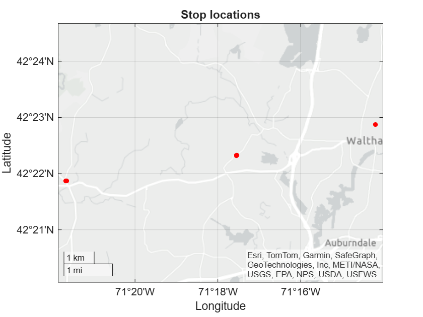

```matlab
T_total = height(TT1);   % seconds (assuming 1 Hz resample)
T_moving = T_total - stopTime;
T_coasting = coastTime;

pie([T_moving-T_coasting, T_coasting, stopTime], ...
    {'Pedaling','Coasting','Stopped'});
title('Ride time distribution');
```

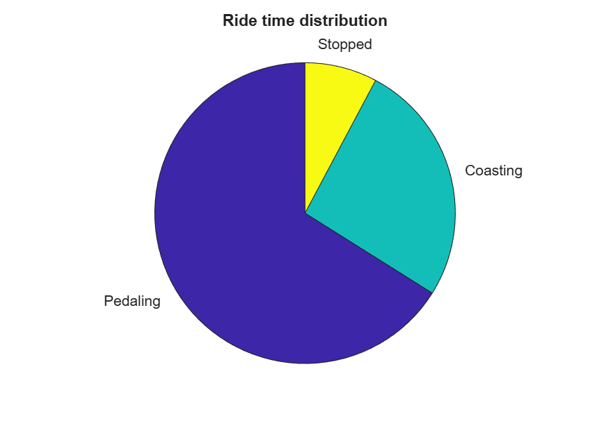

**Acceleration cost**: integral of `max(a,0).*v` → avoid spiky on/off pacing.

<a id="TMP_4b71"></a>

Interpreting the value

-  Units: Joules (energy spent just on accelerations). 
-  Compare it against total ride work (kJ) → see % cost of surges. 

Example:

-  Ride total work ≈ 800 kJ 
-  Acceleration cost ≈ 120 kJ 
-  → ~15% of your effort went into *just accelerating*, not steady motion. 
```matlab
mass = 70 + 10; % let's assume my bike weigh 10 kg
CkJ = accelCost(TT, mass)
```

```matlabTextOutput
CkJ = 71.0182
```

```matlab
WkJ = rideWork(TT, P)
```

```matlabTextOutput
WkJ = 320.1072
```

```matlab
CkJ/WkJ * 100
```

```matlabTextOutput
ans = 22.1858
```

<a id="TMP_7eb7"></a>

## Utils

1) 

```matlab
function TT = prepRide(T) % T is timetable
T = sortrows(T,'timestamp'); 
TT = retime(T,'regular','linear','TimeStep',seconds(1));

% Smooth altitude & grade
alt = smoothdata(TT.enhanced_altitude,'sgolay',31);
d = fillmissing(TT.distance,'linear');
v = TT.enhanced_speed;                    % m/s
g = gradient(alt)./max(gradient(d),1e-6); % grade (rise/run)
a = [0; diff(v)];                          % m/s^2
stopMask = v < 0.5;                        % adjust threshold if needed
TT = addvars(TT,alt,g,a,stopMask,'NewVariableNames', ...
             {'alt_smooth','grade','accel','isStopped'});
end
```

2)

```matlab
function s = baselineStats(TT)
moving = ~TT.isStopped;
gain = sum(max(0,[0; diff(TT.alt_smooth)]));
P = prctile(TT.enhanced_speed(moving),[50 90]);
vam = 3600*gain/seconds(TT.timestamp(end)-TT.timestamp(1));
s = struct('km',TT.distance(end)/1000,'elevGain_m',gain,...
 'movingTime_min',minutes(sum(moving)),'pctStopped', ...
 100*mean(TT.isStopped),'P50_speed_kph',3.6*P(1), ...
 'P90_speed_kph',3.6*P(2),'VAM_mph',vam);
end
```

3)

```matlab
function P = estPower(TT, params)
arguments
  TT timetable
  params.m  double = 70     % rider+bike kg
  params.CdA double = 0.33
  params.Crr double = 0.005
  params.rho double = 1.225
end
v = max(TT.enhanced_speed,0); a = TT.accel;
theta = atan(TT.grade);
Paero = 0.5*params.rho*params.CdA.*(v.^3);
Proll = params.Crr*params.m*9.81.*v.*cos(theta);
Pgrav = params.m*9.81.*v.*sin(theta);
Pinert= params.m.*a.*v;
P = max(Paero+Proll+Pgrav+Pinert,0);
end

function M = loadMetrics(P, dt)
P30 = movmean(P,30);                 % 30s
NP  = (mean(P30.^4))^(1/4);
% Rough FTP: 0.95 * best 20-min power (from estimate)
win = 20*60; best20 = max(movmean(P,win)); FTP = 0.95*best20;
IF = NP/max(FTP,1); TSS = (sum(P)/FTP * dt) / 36; % dt in seconds
M = struct('NP',NP,'FTP_est',FTP,'IF',IF,'TSS',TSS);
end
```

4)

```matlab
function pd = powerDuration(P)
durs = [5 15 30 60 120 300 600 1200]; % s
pd = table(durs', arrayfun(@(w)max(movmean(P,w)), durs)', ...
           'VariableNames',{'sec','bestW'});
end
```

5)

```matlab
function comp = compareRides(TA, TB)
% Expect timetables with variables: timestamp, distance, enhanced_speed, grade (optional)

A = prepForInterp(TA);
B = prepForInterp(TB);

dmax = min(A.d(end), B.d(end));         % common domain (meters)
grid = (0:5:dmax)';                      % every 5 m

tA = interp1(A.d, A.t, grid, 'pchip', 'extrap');   % seconds
tB = interp1(B.d, B.t, grid, 'pchip', 'extrap');
vA = interp1(A.d, A.v, grid, 'linear', 'extrap');  % m/s
vB = interp1(B.d, B.v, grid, 'linear', 'extrap');

if ~isempty(A.g) && ~isempty(B.g)
    gA = interp1(A.d, A.g, grid, 'linear', 'extrap'); % grade (fraction or %)
else
    gA = NaN(size(grid));
end

comp = table(grid, tA, tB, tB - tA, 3.6*vA, 3.6*vB, gA, ...
    'VariableNames', {'m','tA_s','tB_s','timeLead_s','vA_kph','vB_kph','grade'});
end
```

```matlab
function S = prepForInterp(T)
% --- Extract and clean vectors ---
t = seconds(T.timestamp - T.timestamp(1));
d = T.distance;
v = T.enhanced_speed;
g = [];
if ismember('grade', T.Properties.VariableNames)
    g = T.grade;
end

% keep finite rows
mask = isfinite(t) & isfinite(d) & isfinite(v);
if ~isempty(g), mask = mask & isfinite(g); end
t = t(mask); d = d(mask); v = v(mask); if ~isempty(g), g = g(mask); end

% fill small gaps
d = fillmissing(d,'linear','EndValues','nearest');

% fix "lap reset" (distance jumping back to ~0)
off = 0;
for i = 2:numel(d)
    if d(i) < d(i-1) - 10   % drop >10 m → treat as reset; adjust threshold if needed
        off = off + d(i-1);
    end
    d(i) = d(i) + off;
end

% enforce non-decreasing and collapse duplicates
d = cummax(d);                      % eliminate tiny backward jitter
[d, ia] = unique(d, 'stable');      % remove duplicates (interp1 requires unique X)
t = t(ia); v = v(ia); if ~isempty(g), g = g(ia); end

S.d = d; S.t = t; S.v = v; S.g = g;
end

```

5a)

```matlab
function plot_timelead(comp)
% comp.timeLead_s > 0  => Ride B is ahead (A is behind) at that distance
% comp.grade is fraction (e.g., 0.05). If it's % already, delete the 100* below.

Gpct = 100*comp.grade;                  % convert to %
d = comp.m; TL = comp.timeLead_s;

figure('Color','w'); hold on
% color-coded scatter along the route
s = scatter(d, TL, 12, Gpct, 'filled'); %#ok<NASGU>
yline(0,'k-'); grid on
xlabel('Distance (m)'); ylabel('Time Lead (s)');
title('Time Lead vs Distance (colored by Grade)');
cb = colorbar; cb.Label.String = 'Grade (%)';
% optional smoothing overlay
plot(d, smoothdata(TL,'movmedian',21), 'k-', 'LineWidth', 1.2);
hold off
end
```

5b)

```matlab
function bin_table = gains_losses_by_grade(comp)
dTL = diff(comp.timeLead_s);             % per-step time change (s)
Gpct = 100*comp.grade(1:end-1);          % align with dTL

edges = [-Inf -9 -6 -3 0 3 6 9 12 Inf];  % % grade bins
[bin, labels] = discretize(Gpct, edges);

% Sum separately: losses (>0) and gains (<0)
loss = accumarray(bin, max(dTL,0), [numel(labels) 1], @sum, 0); % s
gain = accumarray(bin, -min(dTL,0), [numel(labels) 1], @sum, 0);% s (positive)
bin_table = table(labels', loss, gain, loss-gain, ...
    'VariableNames', {'GradeBin','TotalLoss_s','TotalGain_s','NetLoss_s'});

% quick bar chart
figure('Color','w');
bar(categorical(bin_table.GradeBin), [bin_table.TotalLoss_s bin_table.TotalGain_s], 'stacked');
ylabel('Seconds'); title('Time Lost/Gained by Grade Bin');
legend('Lost (+)','Gained (-)','Location','northwest'); grid on
end
```

6)

```matlab
function CkJ = accelCost(TT, mass)
% TT.enhanced_speed (m/s), TT.accel (m/s^2)
% mass = rider + bike mass in kg

dt = seconds(median(diff(TT.timestamp)));    % time step (s), assuming uniform
a_pos = max(TT.accel, 0);               % keep only positive accelerations
C = mass * sum(a_pos .* TT.enhanced_speed) * dt;   % Joules
CkJ = C/1000;   % kilojoules
end
```

```matlab
function WkJ = rideWork(TT, estP)
% Compute total ride work in kilojoules
dt = seconds(median(diff(TT.timestamp)));   % sampling interval (s)
W = sum(estP) * dt;                    % Joules
WkJ = W / 1000;                        % kilojoules
end
```
